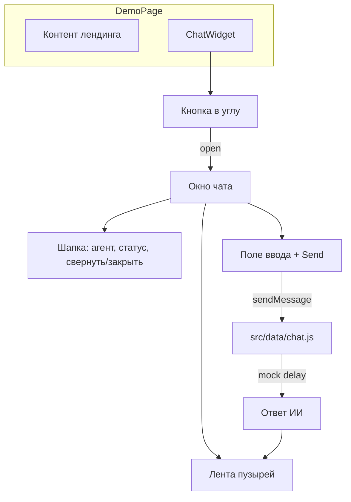

# Frontend чата ИИ-агента в стиле Jivo

## Контекст

Репозиторий [D:\work\Students\wed1930\11\ai-chat](D:\work\Students\wed1930\11\ai-chat) сейчас содержит только правило `[.cursor/rules/mock-data.mdc](.cursor/rules/mock-data.mdc)` — кода приложения нет. Бэкенда нет: ответы агента — через моки и тонкий слой `src/data/` с флагом `USE_MOCK`.

## Стек


| Слой           | Выбор                                                                         |
| -------------- | ----------------------------------------------------------------------------- |
| Сборка         | **Vite** + **React 18** (JavaScript, без TypeScript)                          |
| Стили          | **CSS Modules** + **CSS-переменные** для темы (KISS, без лишних UI-библиотек) |
| Состояние чата | Локальный `useReducer` или `useState` в `ChatWidget` (без Redux)              |
| Данные         | `[src/mocks/](src/mocks/)` + `[src/data/chat.js](src/data/chat.js)`           |


## UX (ориентир Jivo)




- **Плавающая кнопка** (правый нижний угол): иконка чата, при непрочитанном приветствии — точка/счётчик (опционально после первого визита).
- **Панель**: ширина ~380px, высота ~520px на десктопе; на узком экране — почти на весь viewport (как у виджетов).
- **Шапка**: имя агента («Помощник»), подпись «Онлайн», кнопки «свернуть» (в FAB) и «закрыть».
- **Приветствие** при первом открытии (из мока `WELCOME_MESSAGE`).
- **Сообщения**: пользователь справа (акцентный цвет), агент слева с аватаром; время мелким текстом.
- **Индикатор «печатает…»** на время `await delay(600–1200)` перед мок-ответом.
- **Быстрые ответы** (2–3 чипа под приветствием) — отправляют текст как сообщение пользователя.
- **Тема**: переключатель в шапке или в меню «⋯»; значение в `localStorage` (`theme: light | dark`), класс `data-theme` на `document.documentElement`.

## Структура файлов (ключевое)

```
ai-chat/
  index.html
  package.json
  vite.config.js
  src/
    main.jsx
    App.jsx
    pages/
      DemoPage.jsx          # фон «сайта», монтирует ChatWidget
    components/
      chat/
        ChatWidget.jsx        # open/minimize, оркестрация
        ChatPanel.jsx
        ChatHeader.jsx
        MessageList.jsx
        MessageBubble.jsx
        ChatComposer.jsx
        TypingIndicator.jsx
        QuickReplies.jsx
        ChatFab.jsx
    hooks/
      useTheme.js
      useChat.js              # сообщения, send, isTyping
    data/
      chat.js                 # sendUserMessage → mock или будущий fetch
    mocks/
      agent.mock.js           # профиль агента, welcome, quickReplies, replyTemplates
    styles/
      global.css              # reset, переменные темы, шрифт
      tokens.css              # цвета Jivo-подобные (зелёный акцент опционально)
```

## Моки и «ИИ»

Файл `[src/mocks/agent.mock.js](src/mocks/agent.mock.js)`:

- `MOCK_AGENT`: `id`, `name`, `avatarUrl` (placeholder или initials).
- `WELCOME_MESSAGE`, `QUICK_REPLIES` (3–4 фразы на русском).
- `getMockAgentReply(userText, history)` — простые правила (ключевые слова + 1–2 универсальных ответа), возвращает `{ id, role: 'assistant', text, createdAt }`.

`[src/data/chat.js](src/data/chat.js)`:

```javascript
const USE_MOCK = import.meta.env.VITE_USE_MOCK !== 'false';

export async function sendUserMessage(text, history) {
  if (USE_MOCK) {
    await delay(800);
    return getMockAgentReply(text, history);
  }
  // заготовка: POST /api/chat
  throw new Error('API не подключён');
}
```

Соответствует workspace-правилу про моки по умолчанию.

## Визуальный стиль (Jivo-подобный, без копирования бренда)

- Светлая тема: белая панель, светло-серый фон ленты, мягкая тень и скругление 12–16px.
- Тёмная тема: тёмно-серый фон панели, контрастные пузыри.
- Анимации: `transform` + `opacity` для появления панели (200–250ms), плавный скролл к последнему сообщению (`scrollIntoView`).
- Доступность: `aria-label` на FAB и кнопках, `Enter` отправляет (Shift+Enter — новая строка в `textarea` с `rows={1}` и auto-grow по желанию).

## Демо-страница

`[src/pages/DemoPage.jsx](src/pages/DemoPage.jsx)` — короткий лендинг (hero + 2–3 блока текста), чтобы виджет выглядел как на реальном сайте. `[src/App.jsx](src/App.jsx)` рендерит только `DemoPage`.

## Скрипты и env

- `npm run dev` / `npm run build`
- `[.env.example](.env.example)`: `VITE_USE_MOCK=true`
- Краткий `[README.md](README.md)`: запуск, описание виджета, как позже подключить API.

## Что сознательно не входит в первую итерацию

- Реальный streaming SSE/WebSocket (можно заложить комментарий в `chat.js`).
- Вложения файлов, оценка оператора, CRM — только UI-заглушки не делаем, чтобы не раздувать scope.
- Отдельный npm-пакет embed-script (виджет монтируется в React-демо; вынос в `shadow DOM` — возможное расширение позже).

## Проверка после реализации

1. Открыть демо, нажать FAB — приветствие и быстрые ответы.
2. Отправить сообщение — индикатор набора, ответ агента.
3. Свернуть/закрыть, снова открыть — история в сессии сохраняется (state в `ChatWidget`).
4. Переключить тему — панель и демо-страница меняют оформление, перезагрузка сохраняет выбор.

